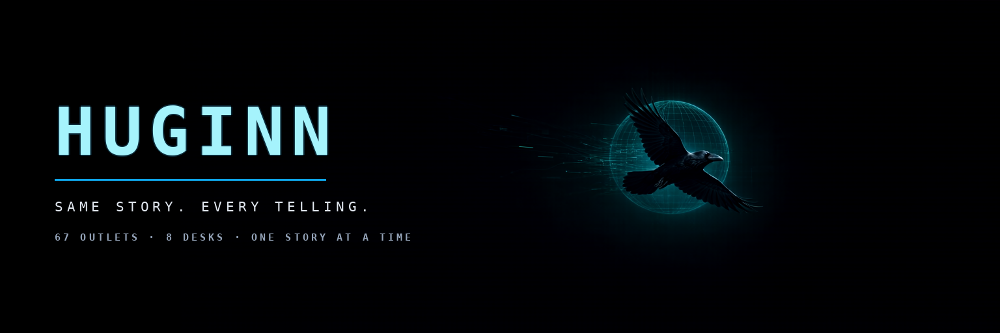
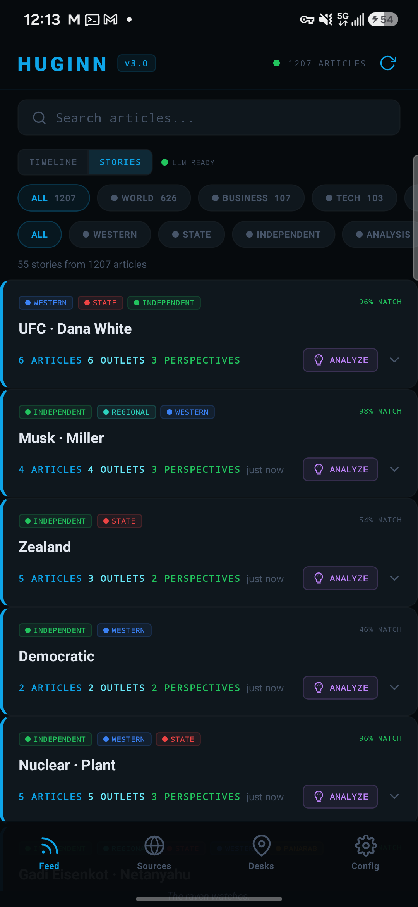
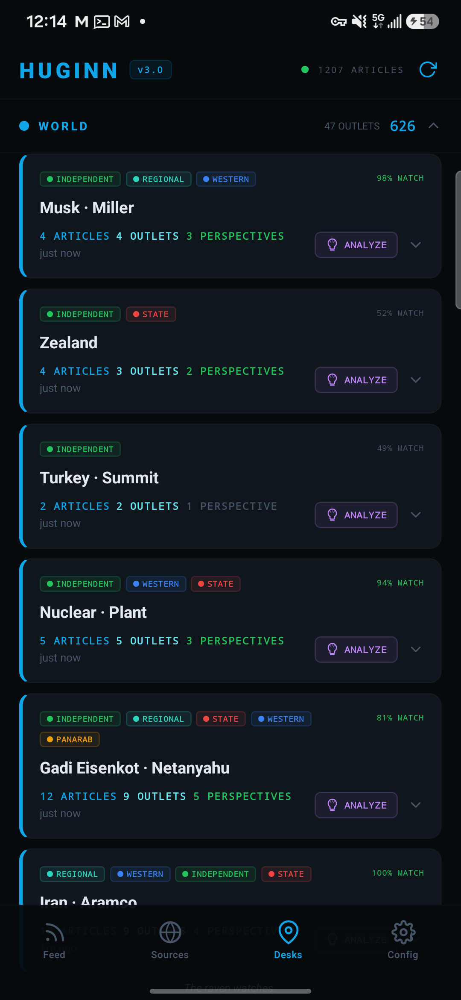

# HUGINN

A multi-source news reader that shows you the *same story* as told by different
outlets, instead of showing you one outlet's version of many stories.

Huginn (Old Norse: "thought") is one of Odin's two ravens, sent out each day to
fly over the world and report back what it saw.

- **No backend.** Feeds are fetched directly from the device. No aggregator API,
  no account, no server, no telemetry.
- **Perspective-tagged.** Every outlet carries its editorial character (western
  wire, state media, independent, pan-Arab, global south, analysis/OSINT).
- **Story clustering.** Articles covering the same event are grouped, so a
  state wire and an exiled opposition paper land side by side.
- **60+ outlets, 8 desks** (world, business, tech, science, health, climate,
  sports, culture) across 9 regions.
- **Optional LLM analysis.** One button sends a story cluster to a local model
  for a framing comparison. Entirely optional — with no endpoint set, the app
  never makes a non-RSS request.

## Screens

<p align="center">
  
  
</p>

| Tab | What it does |
| --- | --- |
| **Feed** | Timeline of every enabled outlet, or **Stories** — clusters covering the same event. Filter by desk and by editorial lean. |
| **Sources** | Toggle feeds, see per-outlet article counts and why a feed failed. |
| **Desks** | Grouped by topic; expanding a desk shows the cross-outlet stories in it. |
| **Config** | Stats, perspective legend, optional analysis endpoint. |

## Run it

```bash
npm install
npx expo start          # scan the QR with Expo Go
# or build a standalone app
npx eas build -p android --profile preview
```

Requires Node 18+. Built with Expo SDK 54 / React Native 0.81.

## Layout

```
App.js            UI (screens, cards, filters)
src/theme.js      every colour in the app (see "Retheming")
src/sources.js    outlet registry: feed URL, desk, region, editorial lean
src/rss.js        RSS 2.0 / Atom parsing
src/cluster.js    story clustering
src/topics.js     article -> desk classification
src/analysis.js   optional analysis backend
src/export.js     optional JSON webhook for pipeline consumers
scripts/          cluster calibration harness, fixture fetcher, banner composer
fixtures/         a saved slice of live headlines, used by the harness
```

## How stories are grouped

`src/cluster.js`, in five steps:

1. **Clean** — strip the " - Outlet Name" suffix that CMSes append, keep proper
   nouns with their original casing for labels.
2. **Tokenize** — fold accents, strip stopwords and news boilerplate
   ("breaking", "says", "amid"), light stemming so *kills* / *killed* /
   *killing* are one term.
3. **Weight** — TF-IDF over the current batch, title terms over description
   terms, proper nouns boosted.
4. **Link** — cosine similarity above threshold ⇒ union-find. A pair that shares
   only one distinctive term must clear a higher bar, so short headlines don't
   merge on a single country name.
5. **Shape** — a story needs 2+ outlets, max 2 articles per outlet, max 12
   articles, 48-hour window. Labels come from the proper nouns the cluster
   agrees on.

Every threshold is calibrated against a real fixture rather than intuition:

```bash
python3 scripts/fetch-fixture.py          # pull ~1100 live headlines
npm run test:cluster                      # compare thresholds, dump clusters
```

The harness also runs the previous algorithm (2 shared raw keywords, anchored on
the first article) so improvements are visible: on a 1127-headline fixture the
old rule produced 136 clusters averaging 3.3 outlets but with labels like
`killed · authorities · say`, while the current engine produces 58 clusters
averaging 3.8 outlets with labels like `Eisenkot · Netanyahu` and
`Egypt · Giza`.

## Retheming

Every colour the UI paints is a token in `src/theme.js` — palette, editorial-lean
map, desk accents, and the structural hairlines. `App.js` holds no hex literals, so
a reskin (dark→light, blue→amber, brand swap) is a single-file diff:

```js
// src/theme.js
export const C = { void: '#0b0b0c', raven: '#f59e0b', /* ... */ };
```

Outlet brand colours are the deliberate exception: they identify a publisher, so
they live next to the outlet in `src/sources.js`.

## Feed quirks worth knowing

Real feeds lie, and the app defends against it rather than trusting them:

- **Outlet names in titles.** Google News and several CMSes append
  ` - Outlet Name`; it's stripped before clustering or it becomes the highest-IDF
  term in the batch.
- **Missing dates.** Some feeds (Press TV) stamp no per-item date at all, only a
  channel `<lastBuildDate>`; that is used as the fallback. Nine date spellings
  are supported (`pubDate`, `published`, `updated`, `dc:date`, `date`,
  `dc:created`, `issued`, `dc:issued`, `created`).
- **Future timestamps.** Some outlets publish 90 minutes into the future, and
  some stamp every item with feed-build time. A negative age used to render as
  "just now" and float those outlets to the top of the timeline, so nothing may
  claim to be newer than the moment it was fetched.
- **Dead routes.** Outlets kill their RSS (AP returns 403, Reuters 401). Where
  that happens the registry points at a Google News `site:` query instead — see
  `src/sources.js`.

## Adding a source

Append an entry to `SOURCES` in `src/sources.js`:

```js
{ id: 'example', name: 'Example Post', region: 'Europe', country: 'Germany',
  lean: 'German Public', leanType: 'western', topic: 'world',
  rss: 'https://example.com/rss.xml',
  fallback: 'https://news.google.com/rss/search?q=site:example.com+when:24h',
  color: '#0e7490', icon: 'EX' }
```

`leanType` must exist in `LEAN_COLORS` (App.js). `topic` must exist in `TOPICS`.
`fallback` is optional — a mirror used when the primary URL 404s or returns
HTML instead of XML.

Verify a candidate feed before adding it: it must return `<item>` or `<entry>`
elements to a plain `fetch` with a normal user agent.

## Optional analysis backend

Config → **Analysis** accepts either

- **Custom /generate** — a JSON endpoint that takes `{prompt, system_prompt}`
  and returns `{response}`: the shape most llama.cpp shims and local agent
  stacks expose, or
- **OpenAI-compatible** — any `/v1/chat/completions` server: `llama.cpp`,
  Ollama, vLLM, LM Studio, OpenAI.

No endpoint ships in the build. To prefill one for your own builds, copy
`.env.example` to `.env` and set:

```bash
EXPO_PUBLIC_HUGINN_BACKEND=generate          # or openai
EXPO_PUBLIC_HUGINN_BACKEND_URL=http://host:5005
EXPO_PUBLIC_HUGINN_MODEL=local-model         # openai only
EXPO_PUBLIC_HUGINN_BACKEND_LABEL=            # optional backend nickname
```

`.env` is gitignored and the values are inlined at bundle time, so a published
build never carries them. Leave it untouched and the ANALYZE button simply
explains that analysis is optional. Analysis is stateless (no conversation
history is written anywhere) and results are cached per cluster until refresh.

## License

MIT — see [LICENSE](LICENSE).
